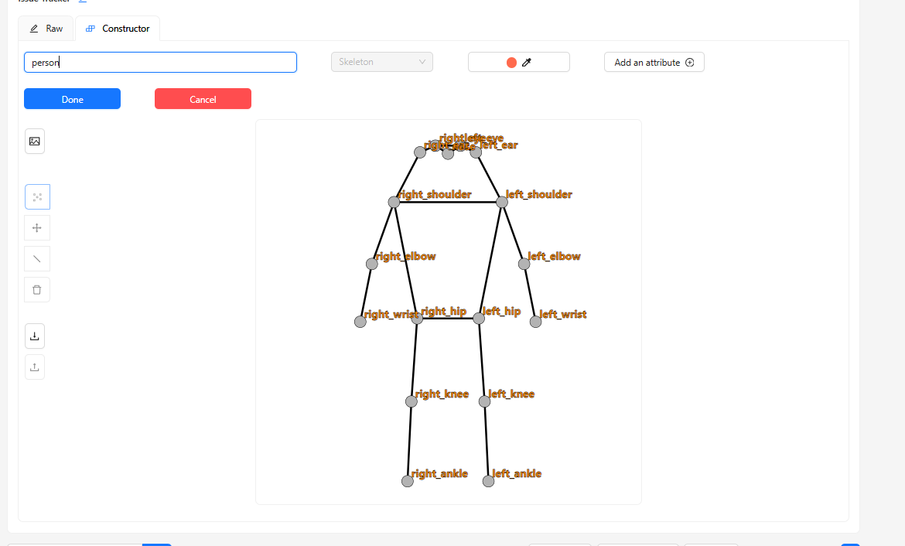
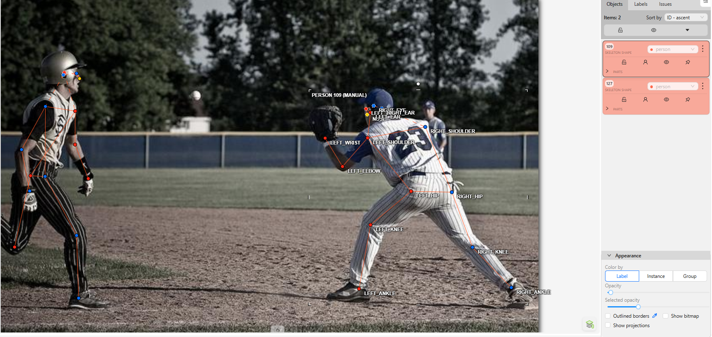
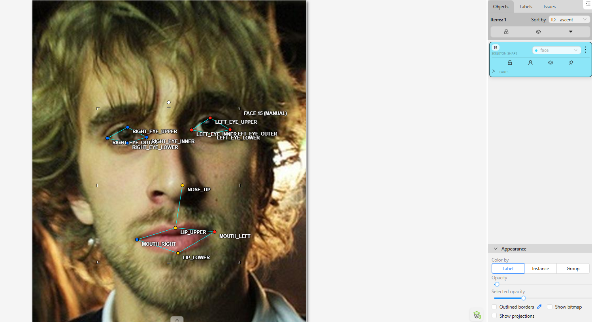
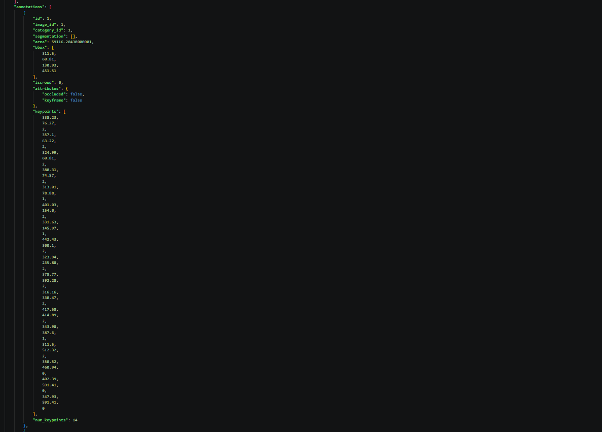

# Báo cáo cá nhân — DinhTuanThanh-2A202603231


## 0. Thông tin học viên

Xác nhận của học viên: theo yêu cầu trực tiếp trong cuộc trao đổi, học viên xác nhận chọn sử dụng nội dung báo cáo hiện tại, bao gồm các mục 3, 4, 7 có AI hỗ trợ. Xác nhận sử dụng báo cáo không có nghĩa mọi lỗi đã được sửa. Học viên cũng xác nhận đã hoàn tất thao tác Finish the job cho cả hai job; chi tiết tại mục 5. Khai báo công cụ AI được giữ tại mục 9.

- Họ tên không dấu: DinhTuanThanh
- MSSV: 2A202603231
- Email: tahanh68@gmail.com
- Repository: https://github.com/tahanh68-arch/K5-L2-Day04-DinhTuanThanh-2A202603231-KeypointPose-Student
- CVAT: 2.74.1 (log setup).
- Máy: Windows. Chưa ghi nhận RAM vật lý và chế độ đầy đủ/lite. Docker được cấp 7,4 GB RAM theo log setup.
- assignment.json: có, tạo bởi lab.py setup.
- Giờ bắt đầu / kết thúc: bắt đầu không rõ , xong 13/11/2026.
- Dữ liệu: ảnh người và mặt cắt từ COCO 2017; nguồn trong src/lab/pool.json.

## 1. Kiểm tra label (CP0)

| Label | Kiểu | Số điểm | Tên và thứ tự | Cạnh |
|---|---|---:|---|---:|
| person | Skeleton | 17 | Script không báo lỗi/cảnh báo tên và thứ tự | Không cảnh báo khác 19 cạnh |
| face | Skeleton | 13 | Script không báo lỗi/cảnh báo tên và thứ tự | Không cảnh báo khác 13 cạnh |

Mẫu person quay mặt về camera, left nằm bên phải mẫu (theo ảnh cấu hình đã xem).

Thao tác theo hướng dẫn repo: rê chuột đúng điểm, bấm Q để bật/tắt occluded hoặc O để bật/tắt outside; có thể dùng menu chuột phải. Chưa ghi nhận học viên đã sử dụng phím hay menu.

## 2. Số lượng đã gán và thời gian (CP1, CP2)

Số skeleton đếm từ file xuất; chưa xác nhận mọi skeleton đều hợp lệ. Đề dự kiến 20 người, file hiện có 21. Trong ảnh 000000508269.jpg, học viên chọn giữ skeleton người nhỏ phía sau dù người này cao dưới 60 px. Việc giữ này khác quy tắc lab và có thể bị tính extra. Không chỉnh sửa file nhãn để loại người này.

| Nhóm | Ảnh | Skeleton | Người dưới 60 px bỏ qua | Poster/gương/màn hình bỏ qua | Phút |
|---|---:|---:|---|---|---|
| easy | 5 | 6 | 0; có 1 người dưới 60 px vẫn được gán | 0 | Gộp trong 120 phút phần người |
| occluded | 3 | 6 | 0 | 0 | Gộp trong 120 phút phần người |
| back | 2 | 4 | 0 | 0 | Gộp trong 120 phút phần người |
| small | 1 | 2 | 0 | 0 | Gộp trong 120 phút phần người |
| crowd | 1 | 3 | 2 | 0 | Gộp trong 120 phút phần người |
| faces | 8 | 8 | — | 0 | 40 |

Thời gian do học viên cung cấp: người 120 phút, mặt 40 phút, tổng 160 phút. Không có số phút riêng từng nhóm người nên không tự chia thời gian cho các nhóm. Chưa có thời gian tự review.

Số đối tượng bỏ qua được bổ sung bằng quan sát ảnh gốc và đối chiếu số skeleton xuất, không phải nhật ký ghi ngay lúc gán. Trong 000000309169.jpg có 2 người rất nhỏ ở xa bên trái, cao khoảng 20–30 px trong ảnh gốc, chưa được gán. Trong 000000508269.jpg, người nhỏ phía sau đã được gán và giữ lại theo lựa chọn của học viên, nên không cộng người này vào cột bỏ qua. Không thấy người rõ ràng trên poster, trong gương hoặc màn hình cần thống kê trong bộ ảnh. Các bóng nhỏ ở nền 000000043968.jpg không đủ căn cứ xác định là người nên không tự cộng vào số lượng.

- Số ảnh xong ở phút 105: không ghi nhận.
- Phút thực tế CP1 / CP2 / CP3: 120 / 40 / chưa ghi nhận (theo thời gian học viên cung cấp).
- Ảnh tốn thời gian nhất và lý do: chưa có thông tin từ học viên.

## 3. Bảng ca khó (CP1, CP2)

Các ca dưới đây do Codex đối chiếu ảnh gốc với nhãn đã xuất theo yêu cầu học viên. Cờ là dữ liệu thật trong ZIP; phần phân tích là nhận xét của trợ lý, không khẳng định đây là lý do học viên đã nghĩ khi gán. Theo RULES.md, học viên cần tự xác nhận và diễn đạt trải nghiệm của mình cho mục này.

| Ảnh | Người/mặt | Điểm | Cờ chọn | Phân vân giữa | Lý do |
|---|---|---|---|---|---|
| 000000043968.jpg | Người trượt tuyết, ann id=3 | left_ear, right_ear | 1, 1 | 1 / 0 | Mũ bảo hiểm che vùng tai; chỉ giữ v=1 nếu vị trí tai đủ chắc từ cấu trúc đầu. Không lấy hình mẫu làm bằng chứng chắc chắn. |
| 000000311300.jpg | Người áo sọc quay lưng, ann id=14 | nose và hai eye | 0 | 1 / 0 | Mặt quay khỏi camera, tóc che đầu; không có căn cứ rõ để đặt mắt/mũi. Cờ hiện tại tránh đoán bừa. |
| 000000123544.jpg | Người áo số 23, ann id=7 | nose và hai eye | 1 | 1 / 0 | Mặt nghiêng và một phần quay khỏi camera; cần xác nhận có đủ căn cứ ước lượng từng điểm. Chưa kết luận mọi điểm v=1 ở đây đều hợp lý. |
| face_514826.jpg | Mặt đeo kính trong, ann id=7 | Hai khóe miệng | 1, 1 | 2 / 1 / 0 | Râu làm khóe môi khó đọc; v=1 chỉ hợp lý nếu bị che nhưng vẫn ước lượng chắc. Không đồng nhất toàn bộ vùng râu với không nhìn thấy. |
| 000000508269.jpg | Người nhỏ ở hậu cảnh, ann id=20 | Toàn skeleton | Có giữ | Gán / bỏ qua | Người dưới 60 px; quy tắc yêu cầu bỏ qua, học viên yêu cầu giữ. Đây là ngoại lệ có chủ ý, không phải trường hợp đáp ứng guideline. |

## 4. Bảng tự review (CP3)

Review : tôi đã trực tiếp xem ảnh gốc và tọa độ trong ZIP, bằng cách dựng lại overlay từ chính dữ liệu xuất, không sinh tọa độ mới và không dùng ground truth. Bộ chính gồm 5 ảnh người (2 back và 1 crowd) cùng 3 ảnh mặt, kiểm theo thứ tự ngược tên ảnh; thêm 2 dòng từ ảnh đã trao đổi. Đây là kết quả review của trợ lý theo yêu cầu học viên, chưa phải bằng chứng học viên đã tự review theo RULES.md. Các dòng ok chỉ xác nhận phạm vi ghi ở cột ghi chú, không bảo đảm toàn bộ skeleton chính xác. Không sửa nhãn hay tự đánh dấu lỗi đã sửa.

| Ảnh | Người/mặt | Điểm | Mã lỗi | Ghi chú | Đã sửa? |
|---|---|---|---|---|---|
| 000000393909.jpg | Người bên trái, ann id=16 | right_wrist | position | Điểm nằm trên phần cẳng tay, chưa tới chỗ nối cẳng tay với bàn tay đang đặt trên con chó; cần đối chiếu lại tâm cổ tay. | Chưa |
| 000000311300.jpg | Người áo sọc quay lưng, ann id=14 | nose, left_eye, right_eye | ok | Ba điểm này có v=0, phù hợp việc không nhìn thấy mặt; có 2 skeleton cho 2 người chính. Chỉ xác nhận cờ các điểm đầu và số lượng. | Không cần sửa trong phạm vi này |
| 000000309169.jpg | Người áo đen phía sau, ann id=12 | left_ankle | position | Điểm v=1 nằm trên nền cỏ, lệch khỏi vùng cổ chân/giày của chân duỗi xuống. Cần lần lại từ hông qua gối tới chân đúng người. | Chưa |
| 000000123544.jpg | Người hậu cảnh sau áo số 23 | Toàn người | missing | Ảnh gốc còn người đứng phía sau, phần đầu và thân lộ cao hơn 60 px; file chỉ có 2 skeleton cho hai người phía trước. Cần kiểm và bổ sung người hậu cảnh theo quy tắc lab. | Chưa |
| 000000043968.jpg | Người trượt tuyết, ann id=3 | Hai ear; số skeleton | ok | Có 1 skeleton người chính; hai tai bị mũ che được đặt v=1. Chỉ xác nhận phạm vi này; cảnh báo trái/phải ở chân vẫn cần lần theo chi. | Không cần sửa trong phạm vi này |
| face_575921.jpg | Mặt, ann id=8 | Cặp mắt và khóe miệng trái/phải | ok | left_eye nằm bên phải ảnh, mouth_left cùng phía; outer xa mũi hơn inner. Không khẳng định mọi điểm mí/môi đã đúng pixel. | Không cần sửa trong phạm vi này |
| face_514826.jpg | Mặt kính trong, ann id=7 | nose_tip | position | Điểm lệch sang phía cánh mũi, chưa ở chóp mũi trung tâm; cần đặt lại mốc giải phẫu. | Chưa |
| face_442231.jpg | Mặt nghiêng, ann id=6 | nose_tip | position | Điểm nằm cao và lệch về sườn mũi so với chóp mũi nhìn thấy. | Chưa |
| 000000508269.jpg | Người nhỏ hậu cảnh, ann id=20 | Toàn skeleton | extra | Người cao dưới 60 px vẫn có skeleton. Học viên yêu cầu giữ nguyên dù khác quy tắc lab. | Không sửa theo lựa chọn học viên |
| face_175798.jpg | Mặt trong ảnh minh chứng số 3 | left_eye_upper, right_eye_upper | position | Hai điểm mí trên có vẻ nằm cao vào vùng lông mày, chưa sát mép mí trên. Đã nêu khi xem ảnh; học viên yêu cầu dùng nguyên ảnh minh chứng. | Chưa |

| lr_swap | vis_flag | position | missing | extra | ok |
|---|---|---|---|---|---|
| 0 | 0 | 5 | 1 | 1 | 3 |

Thống kê đếm theo dòng review, không theo tổng số khớp. Không ghi lr_swap chỉ vì có cảnh báo hình học: người có thể xoay thân hoặc bắt chéo chi. Các cảnh báo ở 000000043968.jpg, 000000123544.jpg và 000000309169.jpg chưa được giải quyết hoàn toàn bằng những dòng review phạm vi hẹp ở trên.

Ca cần xác nhận v=1/v=0: mũi và mắt của người áo số 23 trong 000000123544.jpg hiện có v=1. Nếu không có căn cứ ước lượng chắc từng điểm thì cần v=0. Chưa có quyết định mới của học viên và chưa chỉnh nhãn.

## 5. Kiểm file xuất và kết quả tự kiểm (CP4)

Đã chạy check_submission.py. Không chỉnh sửa JSON xuất. Kết quả đầy đủ: [kiem_tra_submission.txt](../../src/exports/kiem_tra_submission.txt).

| File | Ảnh | Skeleton | Số phần tử keypoints | v=2 | v=1 | v=0 | num_keypoints trung bình |
|---|---:|---:|---:|---:|---:|---:|---:|
| DinhTuanThanh_persons.zip | 12 | 21 | 51 | 235 | 71 | 51 | 14,6 |
| DinhTuanThanh_faces.zip | 8 | 8 | 39 | 94 | 10 | 0 | 13,0 |

Kết quả: ĐẠT định dạng; 0 lỗi, 6 cảnh báo. Chưa chứng minh điểm đúng khớp. 51 điểm v=0 giữ tọa độ cũ là bình thường với CVAT 2.x. Script không phát hiện num_keypoints sai hay điểm v>0 ngoài ảnh.

Kiểm tay 2 người và 1 mặt:

| File | Ảnh, annotation | Số phần tử | Cờ khớp CVAT? | num_keypoints khớp? |
|---|---|---|---|---|
| DinhTuanThanh_persons.zip | 000000030960.jpg, annotation id=1 | 51 | JSON có 3 điểm v=1 và 3 điểm v=0; chưa đối chiếu thao tác trên CVAT | Khớp: 14 điểm v>0, num_keypoints=14 |
| DinhTuanThanh_persons.zip | 000000030960.jpg, annotation id=2 | 51 | JSON có hai cổ chân v=0; chưa đối chiếu thao tác trên CVAT | Khớp: 15 điểm v>0, num_keypoints=15 |
| DinhTuanThanh_faces.zip | face_147624.jpg, annotation id=1 | 39 | JSON có 13 điểm v=2; chưa đối chiếu thao tác trên CVAT | Khớp: 13 điểm v>0, num_keypoints=13 |

Trong JSON người id=1, right_ear, right_shoulder và right_hip có v=1; right_knee và hai cổ chân có v=0. Các điểm v=0 vẫn giữ tọa độ cũ. Việc kiểm JSON không thay thế bước xác nhận cờ tương ứng trên CVAT.

Danh sách ảnh của cả hai ZIP khớp hoàn toàn assignment.json. Mỗi ZIP chỉ chứa annotations/person_keypoints_default.json, không kèm ảnh.

Cảnh báo cần xem trên CVAT; chưa kết luận là lỗi:

| Ảnh | Skeleton thứ tự trong file | Cảnh báo |
|---|---:|---|
| 000000043968.jpg | 1 | knee, ankle ngược phía các cặp khác |
| 000000123544.jpg | 2 | hip, knee ngược phía các cặp khác |
| 000000225138.jpg | 1 | knee ngược phía các cặp khác |
| 000000309169.jpg | 1 | hip, knee, ankle ngược phía các cặp khác |
| 000000508269.jpg | 1 | Điểm trải cao 46 px; kiểm người dưới 60 px hoặc bị cắt khung |
| 000000508269.jpg | 2 | knee, ankle ngược phía các cặp khác |

Cảnh báo kích thước của người nhỏ trong 000000508269.jpg được giữ theo lựa chọn của học viên. Skeleton trải cao 45,66 px; ảnh gốc 500 × 375 px và người nhỏ phía sau cao khoảng 50 px. Việc giữ người này không đáp ứng quy tắc bỏ qua người dưới 60 px. Review trực quan có AI hỗ trợ ở mục 4 phát hiện thêm lỗi nhưng chưa sửa nhãn; không coi cảnh báo trái/phải là đã giải quyết hay tự động kết luận tất cả đều là lỗi thật.

Hai job completed: Có, theo xác nhận trực tiếp của học viên đã lưu và thực hiện Menu → Finish the job cho cả job persons (task 13, job 13) và faces (task 14, job 14). Trợ lý không kiểm tra trực tiếp trạng thái trên giao diện CVAT.

```text
----- TÓM TẮT (dán vào báo cáo mục 5) -----
- File person: DinhTuanThanh_persons.zip
  Số ảnh: 12 · số skeleton `person`: 21 · mỗi annotation 51 số
  Skeleton theo ảnh: 000000030960=2, 000000043968=1, 000000072098=1, 000000106051=2, 000000123544=2, 000000177889=1, 000000225138=1, 000000309169=3, 000000311300=2, 000000393909=2, 000000467300=2, 000000508269=2
  Cờ v: v=2 235 (66%) · v=1 71 (20%) · v=0 51 (14%)
  num_keypoints trung bình: 14.6
- File face: DinhTuanThanh_faces.zip
  Số ảnh: 8 · số skeleton `face`: 8 · mỗi annotation 39 số
  Skeleton theo ảnh: face_147624=1, face_175798=1, face_264124=1, face_294580=1, face_300399=1, face_442231=1, face_514826=1, face_575921=1
  Cờ v: v=2 94 (90%) · v=1 10 (10%) · v=0 0 (0%)
  num_keypoints trung bình: 13.0
- Ghi chú: 51 điểm v = 0 vẫn mang tọa độ cũ (CVAT 2.x xuất như vậy; chuẩn COCO ghi 0, 0). Không phải lỗi: điểm v = 0 bị bỏ qua khi huấn luyện và khi chấm.
- Số [LỖI]: 0 · số [CẢNH BÁO]: 6
Kết quả: ĐẠT (đọc lại từng cảnh báo ở trên)
```

## 6. Ảnh chụp màn hình

Đã lưu 4 ảnh màn hình học viên cung cấp, giữ nguyên nội dung ảnh theo lựa chọn của học viên:

1. Cấu hình label person (tên một số điểm vùng đầu bị chồng nhau trong ảnh chụp):

   

2. Người quay lưng trong ảnh 000000123544.jpg đã gán skeleton, có hiển thị tên điểm và đường nối:

   

3. Mặt face_175798.jpg đã gán 13 điểm, phóng to vùng mắt và miệng:

   

4. JSON của người trong 000000030960.jpg, annotation id=1, có keypoints và num_keypoints=14 (chữ trong ảnh chụp nhỏ):

   

Nguồn ảnh trong job: COCO 2017.

## 7. Tự đánh giá

1. Trong mẫu review hỗ trợ, mã position có nhiều dòng nhất (5/10 dòng). Các lỗi liên quan việc đặt điểm theo vùng nhìn chung thay vì đúng mốc giải phẫu. Hướng khắc phục: phóng to, phân biệt chóp mũi với cánh mũi, mép mí với lông mày, cổ tay với cẳng tay; kiểm từng điểm sau khi kéo mẫu. Chưa đủ căn cứ khẳng định đây là lỗi học viên mắc nhiều nhất trong toàn bài.
2. Đề xuất bổ sung checklist trước khi lưu: với eye_upper, yêu cầu đối chiếu mép mí ngay trên con ngươi và bảo đảm không đặt lên lông mày; ví dụ ảnh face_175798.jpg. Với cảnh đông người, đếm lại người hậu cảnh cao từ 60 px trước khi chuyển ảnh, ví dụ 000000123544.jpg. Đây là đề xuất kỹ thuật của trợ lý để học viên xem xét.
3. Chưa có bằng chứng một lỗi trong bảng đã được sửa, nên không mô tả thành “lỗi đã sửa”. Phân tích một lỗi đang còn: nếu nose_tip lệch sang cánh mũi và giữ v=2, heatmap đích sẽ có đỉnh ở vị trí sai, model được huấn luyện kéo dự đoán về cánh mũi; khi so với chóp mũi đúng, sai số vị trí tăng. Tương tự, eye_upper nằm ở lông mày làm khoảng cách mí trên–mí dưới sai và có thể làm sai phép đo độ mở mắt. Sau khi học viên thực sự sửa và xuất lại, mới ghi nhận là lỗi đã sửa.

## 8. Khó khăn và lỗi kỹ thuật

Log setup cho thấy Docker 29.9.3 và CVAT 2.74.1 hoạt động; OPA đã nạp 445 quy tắc và các task đã được tạo.
## Bonus

Không có file bonus trong thư mục xuất, không kê khai điểm bonus.

## 9. Tài liệu tham khảo và công cụ AI đã dùng

- docs/GUIDELINE.md, docs/CVAT_CHEATSHEET.md, docs/COCO_KEYPOINTS.md.
- Nguồn ảnh: src/lab/NGUON_ANH.md và src/lab/pool.json.
- ChatGPT/Codex:  hướng dẫn CVAT.
